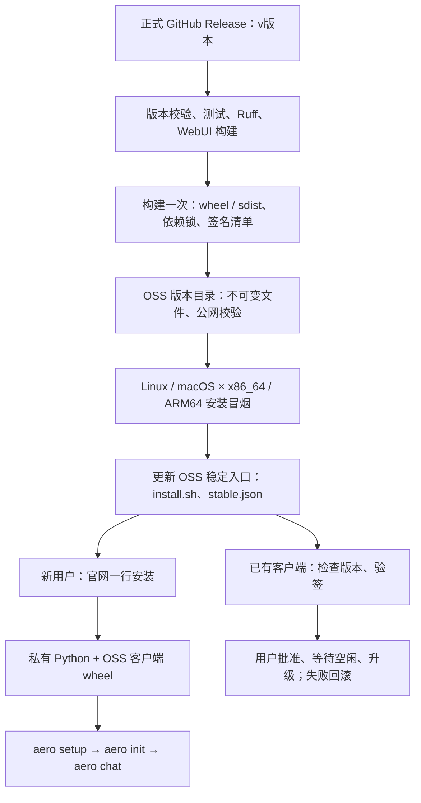

# 客户端发布

当前仅发布到 OSS，暂不向 PyPI 或 TestPyPI 发布 Aerolytica 包。
版本唯一来源是 `pyproject.toml` 的 `project.version`，发行包名为 `aerolytica`。
命令、import 包仍为 `aero`，TUI/CLI 从已安装 metadata 读取版本；源码开发回退读取
pyproject。发布不会自动篡改版本号：先修改版本，再建完全一致的 `v<版本>` tag。

## 流程和闸门

`.github/workflows/ci.yml` 在 main/PR 执行四平台 Python 3.12 测试、Ruff、WebUI
检查/构建、wheel/sdist 校验，无发行密钥。生产 `.github/workflows/release.yml`
正式 Release published 自动选择 `production`，不发布 prerelease；也可手动选择
`testing` 或 `production` 和已有 tag。两个环境分别串行，不会取消前一发行。
所有 job 显式绑定所选 GitHub Environment，使用该环境的 Variables/Secrets。

正式 Release → checkout tag → 验证版本与 main 祖先关系 → 测试/WebUI →
构建一次签名 wheel/sdist/清单 → 上传不可变 OSS 文件并检查公网映射 →
四平台从 OSS 脚本安装、setup/doctor/冒烟 →
最后更新 OSS `install.sh` 和 `stable.json`，无需等待 PyPI 组织审批。



上图仅展示 OSS 发布、安装与升级链路，不展开第三方依赖下载来源。

测试失败、格式检查失败、依赖缺 wheel 或 OSS 失败均阻止稳定入口推进，
没有忽略错误的生产分支。现有仓库测试/格式问题需先处理，不能用跳过检查上线。
一般开发 wheel 构建不需要签名密钥；正式发行构建在临时源码副本嵌入公钥。
私钥只在构建步骤环境中使用，不写入源码、wheel、sdist 或日志。

## GitHub / OSS 配置

当前生产 workflow 不使用 PyPI Environment、Trusted Publisher 或 OIDC 发布权限。

先在仓库 Settings → Environments 创建 `production`、`testing`。下面配置分别填入
两个环境，不同后端地址、发布前缀与密钥不要共用配置。生产环境可启用部署审批。
环境名由 workflow 决定，无需另外配置 `AERO_ENVIRONMENT` Variable。

GitHub Environment secrets：

| Secret | 用途 |
| --- | --- |
| `OSS_ACCESS_KEY_ID` | 仅 OSS 上传步骤使用 |
| `OSS_ACCESS_KEY_SECRET` | 仅 OSS 上传步骤使用 |
| `RELEASE_SIGNING_KEY` | base64 编码的 Ed25519 32-byte seed，仅签名构建步骤使用 |

GitHub Environment variables：

| Variable | 配置 |
| --- | --- |
| `OSS_BUCKET` | 已存在的发布 bucket 名称 |
| `OSS_ENDPOINT` | bucket 区域 HTTPS endpoint |
| `OSS_PREFIX` | 必填；生产 `download`，测试例如 `download/testing`；不允许 bucket 根目录 |
| `AERO_DOWNLOAD_BASE` | 必填；生产 `https://aero.skyviewor.com/download`，测试填实际测试前缀的公网 HTTPS 地址 |
| `AERO_OFFICIAL_API_URL` | 必填；该环境的平台 API HTTPS 地址（生产 `https://api.aerolytica.skyviewor.team`） |
| `AERO_OFFICIAL_LLM_URL` | 必填；该环境的 LLM 网关 HTTPS 地址，含 `/v1`（生产 `https://llm.aerolytica.skyviewor.team/v1`） |
| `RELEASE_PUBLIC_KEYS` | 可选，key-id → base64 公钥的 JSON；用于提前分发新公钥 |

密钥必须由维护者在受控环境生成并直接保存为 Secret，不要提交或粘贴进 issue。
OSS RAM 权限只需这个发布前缀的对象读取/写入；不需要删除对象或 bucket 管理权限。
公网需要匿名读取；对象必须经 HTTPS 提供，CDN/反向代理应尊重稳定对象 no-cache。
不要为排错打印环境变量、Secret 或 OSS SDK 的签名请求异常。

### 后端地址、用户状态与升级隔离

CI 将环境名、API/LLM 地址和下载入口写入 wheel 的 `release_environment.json`，
并纳入签名发行清单。安装脚本也内置所选环境和下载入口，用户无需手动 export。
测试地址未配置时构建失败，绝不使用生产地址替代。地址不包含凭据；客户端需要
连接的地址必然可以从安装包读取，不能将域名当作秘密或鉴权措施。

生产入口仍为 `aero`，默认用户目录 `~/.aero`；测试入口为 `aero-testing`，默认目录
`~/.aero-testing`。登录凭据、Agent 注册与锁、用户会话、科研运行时及升级记录隔离。
两个环境可以同时安装；测试版升级不会改写生产版入口，也拒绝安装生产清单。
系统后台服务名称和持久化环境同样分开。已有生产目录不搬迁、不修改账号数据。
工作区内用户主动选择的项目文件仍共享，不复制或清理科研数据。

运行时显式 `AERO_OFFICIAL_API_URL` / `AERO_OFFICIAL_LLM_URL` 覆盖仍可用于本地联调。
不要用 `AERO_ENVIRONMENT` 把已构建的测试安装包切成生产版，这种不一致会被拒绝。
源码/普通 pip 构建默认生产；源码测试模式须显式设置两个后端地址，检查更新还需设置
测试 `AERO_DOWNLOAD_BASE`。升级读取新安装包的默认地址，旧默认值不会继承为覆盖值。

正式 Release 自动走生产；测试在 Actions 中手动运行 Publish Aerolytica to OSS，
选择 `testing` 和匹配版本的已有 tag。同一版本可在两个独立前缀各构建一次；
每个前缀内不可覆盖同版本产物。仍不向 PyPI 发布。

### 本地生成签名密钥与备份

在已安装开发依赖的本地交互式终端运行：

```bash
uv run --locked python scripts/release/generate_keys.py --environment production
```

测试密钥使用 `--environment testing` 单独生成。参数仅标注环境，不创建或配置
GitHub Environment。脚本显示私钥、公钥、密钥标识、生成时间，以及符合发行格式的
`RELEASE_PUBLIC_KEYS` JSON；不联网上传、不写文件、不修改已有配置。
私钥填入 GitHub Secret `RELEASE_SIGNING_KEY`，公钥 JSON 可填入 Variable
`RELEASE_PUBLIC_KEYS`（首次可不填，构建器会自动嵌入当前公钥）。

执行前关闭录屏/共享屏幕；将完整输出保存到 1Password 等密码管理器，生产/测试
分别标注，保存后清理终端记录。私钥不能仅依赖 GitHub Secret 作为唯一备份。
脚本拒绝管道和重定向输出，避免私钥意外落入日志或仓库文件；不要在 CI 中运行。
每次执行都会生成新密钥，不能当作读取旧密钥的命令。已发布后必须按轮换流程
分发新公钥再更换私钥，并合并保留所需历史公钥条目。

## OSS 布局

```text
download/
  install.sh                         # 成功发布后才推进
  stable.json                        # 签名清单，最后一步推进
  releases/<版本>/
    aerolytica-<版本>-py3-none-any.whl
    requirements.txt                 # uv.lock 导出的平台标记 + SHA256 锁
    bootstrap.py
    install.sh
    release.json
    aero-<平台>.tar.gz               # 同一 wheel 的兼容归档
    *.sha256
  bootstrap/uv/<固定版本>/<target>.tar.gz
  bootstrap/python/<固定构建>/<平台>.tar.gz
```

归档的固定平台名不表示客户端有四种二进制 wheel：客户端是一个跨平台 wheel；
私有 Python/uv 和依赖中的原生 wheel 按平台选择。引导工具版本由
`scripts/release/toolchain.json` 与 install.sh 同步固定，构建器会校验一致性。
新 Python 解释器用独立目录，不向活动解释器重复解压。依赖下载必须匹配锁中的 hash。

`dist/release/pypi/` 仍是本地 wheel/sdist 构建目录名，不表示执行网络发布。
官方安装与升级从 OSS 取得 Aerolytica wheel；第三方 Python 依赖仍从 PyPI 或配置的
镜像下载，科研环境依赖仍从 conda-forge 或镜像下载。暂停的是 Aerolytica 包发布，
不是禁用所有依赖仓库。

## 重试、回滚与公钥轮换

构建结果保留为 GitHub Artifact 90 天。部分失败时用“Re-run failed jobs”，
复用同一 wheel/sdist，勿修改 Release 描述或公钥配置后重新构建已发布版本。
已存在的 OSS 不可变对象必须与本次 hash 完全相同，否则拒绝覆盖。
新的全量构建也使用 SOURCE_DATE_EPOCH 和无路径头的依赖导出，避免时钟/临时路径漂移。
旧版本 Release 重新跑不会把 stable 降级；客户端也不自动降级。

需要撤销发行时，先修复并发布更高版本；用户可显式 `aero update --rollback`。
不要覆盖同版本产物或删除用户正在使用的历史 OSS 产物。

公钥轮换分两次发行：先把新公钥放入 RELEASE_PUBLIC_KEYS，仍用旧私钥签名；
待客户端获得新公钥后，再切换 RELEASE_SIGNING_KEY。历史公钥不能直接移除，
否则未更新的用户无法验证下一版。首次安装依赖官方 HTTPS 信任入口。

## 暂停 PyPI / TestPyPI

正式发布已移除 PyPI job，OSS 推进直接依赖四平台安装冒烟。
未来恢复 PyPI 发布时，需重新加入发布 job 与依赖闸门，并为 `aerolytica` 配置
Trusted Publisher：owner/repository 为 `skyviewor` / `Aerolytica`，workflow 为
`release.yml`，GitHub Environment 为 `pypi`。首次发布需确认项目名所有权，
可用 pending publisher；不需要 PyPI API token。

`.github/workflows/testpypi.yml` 保留为手动演练，但默认暂停：仅在 repository variable
`ENABLE_TESTPYPI_PUBLISH` 明确设置为字符串 `true` 后才执行，不写 OSS、不推进 stable。
TestPyPI 配置相同项目的 pending/trusted publisher，workflow 为 `testpypi.yml`，
environment 为 `testpypi`。选择已有且与 pyproject 完全匹配的 tag。
TestPyPI 不含生产签名公钥，不用于验证生产自动更新。

## 上线验收

首次生产发布前确认：所有测试/格式检查通过；四平台 shell 安装通过；
账号向导不会初始化项目；`setup --runtime-only --yes` 和 doctor 成功；
空闲更新/忙碌撤回/后台 cwd 恢复/失败回滚验证通过；官网指向公开且有正确缓存策略的
bucket 前缀；OSS 上传密钥与发行签名密钥已配置。
本地验签/切换/真实构建测试不替代 Linux/macOS 四平台的真实安装验收。
